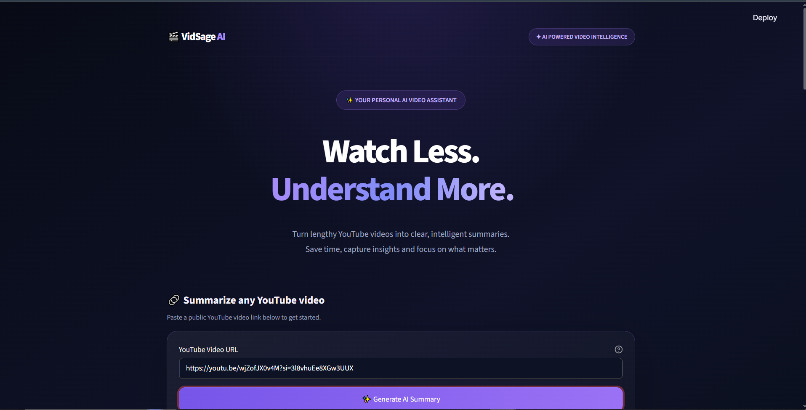
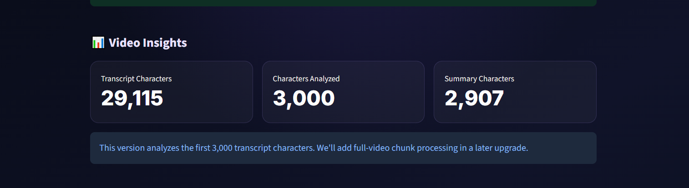
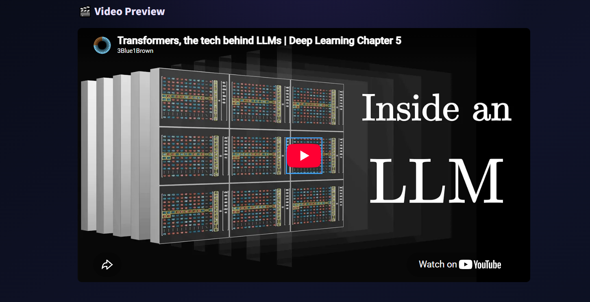
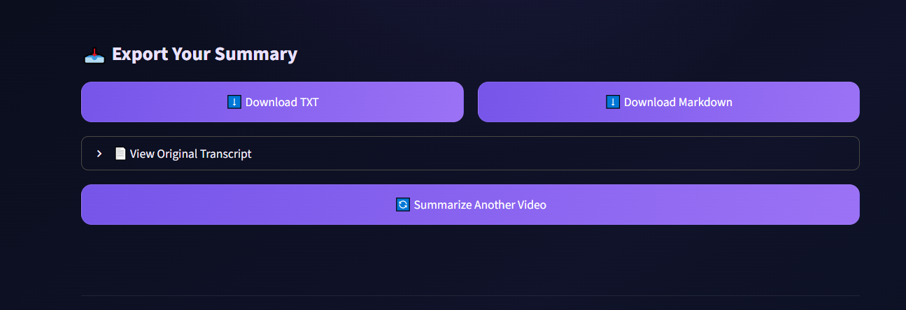

# 🎬 VidSage AI

### AI-Powered YouTube Video Summarizer

VidSage AI is an AI-powered application that extracts transcripts from YouTube videos and transforms them into clear, structured summaries using Google Gemini.

Paste a YouTube video URL and let AI generate a concise summary, important key points, video insights, and more.

## ✨ Features

- 🎥 **YouTube Transcript Extraction** – Extracts available transcripts from YouTube videos.
- 🤖 **AI-Powered Summarization** – Generates structured summaries using Google Gemini.
- 🔑 **Important Key Points** – Highlights five important points from the video.
- 📚 **Video Insights** – Identifies main topics and important facts.
- 👀 **Video Preview** – Preview the YouTube video inside the application.
- 📥 **Downloadable Summaries** – Export summaries in TXT and Markdown formats.
- 🌙 **Modern UI** – Clean, responsive interface with a dark theme.

## 📸 Screenshots

### Dashboard


### AI Generated Summary


### Video Insights


### Video Preview


### Export Summary


## 🛠️ Technologies

- Python
- Streamlit
- Google Gemini API
- YouTube Transcript API
- python-dotenv

## ⚙️ Installation & Setup

**1. Clone the repository**

```bash
git clone https://github.com/21vicky/VidSage-AI.git
cd VidSage-AI
```

**2. Create a virtual environment**

```bash
python -m venv venv
```

**3. Activate the virtual environment (Windows)**

```powershell
venv\Scripts\activate
```

**4. Install dependencies**

```bash
pip install -r requirements.txt
```

**5. Configure your Gemini API key**

Create a `.env` file in the project root:

```env
GEMINI_API_KEY=your_gemini_api_key
```

Never upload your `.env` file or expose your API key.

**6. Run the application**

```bash
streamlit run app.py
```

## 📌 Project Status

✅ Core application implemented  
✅ YouTube transcript extraction  
✅ Gemini-powered video summarization  
✅ Summary insights and export functionality  
🚧 Full transcript processing improvements planned

## 👨‍💻 Developer

**Vignesh U**

GitHub: [@21vicky](https://github.com/21vicky)

---

⭐ If you find this project useful, consider giving it a star!